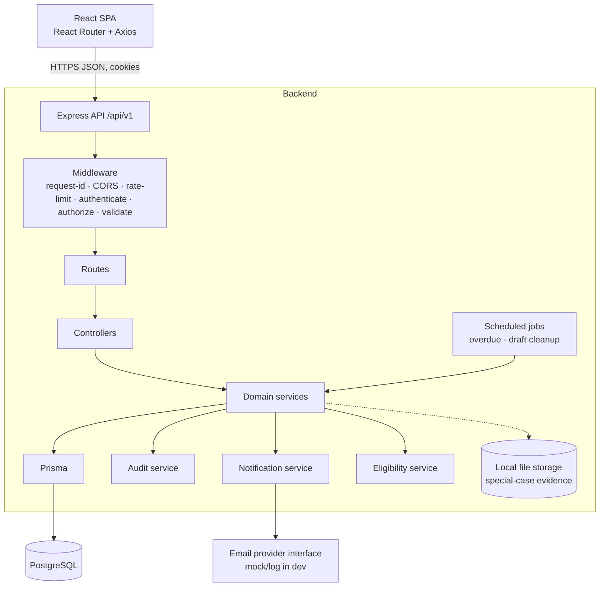

# Architecture

**Style:** modular monolith — one Express backend with clear module boundaries, a React SPA frontend (later), PostgreSQL via Prisma. No microservices, no event bus, no Redux. Chosen so a four-person team can deliver in about eight weeks.

## 1. System overview



**Request lifecycle:** request → request-id/logging → CORS/rate limit → `authenticate` (cookie JWT) → `authorize` (role) → `validate` (Zod) → route → controller → service (business rules + scope) → Prisma → response envelope. Errors anywhere are thrown as typed errors and converted by one central handler.

## 2. Layer responsibilities

| Layer | Does | Must not |
|---|---|---|
| Route | Maps URL + method to middleware chain + controller | Contain logic |
| Controller | Reads validated input, calls one service method, shapes the HTTP response | Query the database, hold business rules |
| Service | Business rules, state transitions, scope enforcement, transactions, audit/notification calls | Touch `req`/`res` |
| Prisma | The only data access | Be imported by controllers/routes |
| Middleware | Cross-cutting: auth, role gate, validation, errors, rate limit | Contain feature logic |

> **Security boundary:** the backend. Every service method receives the authenticated user and applies role/ownership/department/assignment scope **inside the query** (e.g. `where: { id, studentId: user.id }`). Frontend guards are only for usability.

## 3. Proposed backend layout

```
backend/
├── prisma/
│   ├── schema.prisma
│   ├── migrations/
│   └── seed.js                  # mock data only
├── src/
│   ├── server.js                # starts HTTP server, jobs
│   ├── app.js                   # builds Express app (importable by tests)
│   ├── config/                  # env loading + validation, constants, settings defaults
│   ├── common/
│   │   ├── errors/              # AppError, NotFoundError, ForbiddenError, ConflictError, ...
│   │   ├── middleware/          # authenticate, authorize, validate, errorHandler, rateLimit
│   │   ├── utils/               # pagination, dates (working days), reference, response helpers
│   │   └── prisma.js            # single PrismaClient instance
│   ├── modules/
│   │   ├── auth/                # routes · controller · service · schema (Zod)
│   │   ├── users/
│   │   ├── academic/            # departments, units, enrollments, lecturer assignments
│   │   ├── reports/             # reports, comments, decisions, state machine
│   │   ├── appeals/
│   │   ├── notifications/       # service + providers/ (mock email)
│   │   ├── audit/
│   │   ├── eligibility/
│   │   ├── attendance/          # (Phase 2) sessions, records, history, discrepancies
│   │   ├── assessments/         # (Phase 3) CAT, exam QR
│   │   ├── special-cases/       # (Phase 3) evidence uploads
│   │   ├── reporting/           # (Phase 4) stats, exports
│   │   └── admin/               # (Phase 4) settings, maintenance, archive
│   ├── routes/index.js          # registers each module router under /api/v1
│   └── jobs/                    # (Phase 4) overdue, draft cleanup
└── tests/                       # unit · integration · helpers (see backend/tests/README.md)
```

Each module folder: `<module>.routes.js`, `<module>.controller.js`, `<module>.service.js`, `<module>.schema.js`. **Modules talk to each other through service functions, never by reaching into another module's Prisma queries or internals.** Shared helpers go in `common/`.

## 4. Cross-cutting concerns

| Concern | Approach |
|---|---|
| **Authentication** | JWT access (short) + refresh (rotated, hash stored) in HttpOnly cookies; bcrypt; lockout fields on `User` |
| **Authorization** | `authorize(...roles)` middleware for coarse role gates + service-level scope for ownership/department/assignment |
| **Validation** | Zod schemas per route for body, params and query; invalid input → `422 VALIDATION_ERROR` |
| **Errors** | Typed `AppError` subclasses → central handler → standard envelope; unknown errors become generic `500`, details logged server-side only |
| **State transitions** | One `report-state-machine` module owns the allowed-transition table; services call it; no status updates anywhere else |
| **Transactions** | `prisma.$transaction` for submit/transition (report + status history + audit + notification) and attendance record + history |
| **Audit** | `audit.record({ actor, action, entityType, entityId, reason, previousValues, newValues }, tx)` — accepts a transaction client; append-only; never stores secrets |
| **Notifications** | `notify(...)` writes in-app rows and calls the email provider interface; mock provider logs; swap providers without touching callers |
| **Eligibility** | Standalone service with a stable interface (`evaluate(studentId, unitId)` → classification + explanation). MVP stub; real engine in Phase 3 |
| **Configuration** | `.env` for environment; business thresholds in `SystemSetting` with defaults from env; env validated at startup (fail fast) |
| **Logging** | Console, one structured line per request/event; no passwords, tokens, reset links or precise location |
| **File storage (P3)** | Local folder outside public static dirs; DB stores metadata + generated filename; downloads only through an authorized endpoint; Multer only on the evidence endpoint |
| **Scheduled work (P4)** | `node-cron` style jobs calling services; simple, no queues |
| **Rate limiting** | Stricter limit on login/password-reset; general limit elsewhere |
| **API docs** | OpenAPI file in `docs/api/`, Swagger UI served at `/api/docs` in non-production |

## 5. Technology choices

| Area | Choice | Notes |
|---|---|---|
| Runtime / framework | Node.js LTS + Express | REST + JSON, versioned `/api/v1` |
| Language | JavaScript (CommonJS) | Decision P-01 in meeting notes |
| ORM / DB | Prisma + PostgreSQL | Prisma Migrate for schema changes |
| Validation | Zod | |
| Auth | `jsonwebtoken`, `bcrypt`, `cookie-parser` | |
| Security middleware | `helmet`, `cors`, `express-rate-limit` | |
| Uploads (P3) | Multer | Special-case evidence only |
| QR (P2) | `qrcode` | Server generates QR image of the session link |
| PDF / Excel (P4) | `pdfkit` / `exceljs` | Decision D-15 |
| Testing | Jest + Supertest | Separate test database |
| Lint / format | ESLint + Prettier | Enforced in CI |
| Frontend (later) | React, React Router, Axios, CSS Modules, `useState`/`useContext` | No Redux/Zustand/TanStack Query initially |

Add a dependency only with a reason in the PR description.

## 6. Security architecture summary

- Least privilege; deny by default; scope inside queries (prevents IDOR).
- Never trust client input: IDs, statuses, coordinates, QR references and file metadata are validated server-side.
- QR/link = *session locator*, not authority; authentication, enrollment, validity, duplicate and location checks always run.
- Location is an input, not proof; failed check ≠ absent.
- Uploaded file names are generated; MIME + extension + size validated; no executable content; served only via authorized endpoints.
- Cookies HttpOnly (+ Secure in HTTPS); strict CORS; helmet headers; rate limits; lockout.
- Secrets only in `.env` (never committed); `.env.example` has placeholders.
- Audit trail for security-relevant and decision events.

## 7. Architecture decision records (summary)

| # | Decision | Reason |
|---|---|---|
| A1 | Modular monolith | Team size, timeline, simpler debugging and deployment |
| A2 | Service layer owns business rules | Testable without HTTP; one place per rule |
| A3 | Single state-machine module for reports | Prevents illegal transitions scattered across code |
| A4 | Withdrawn/Overdue are not statuses | Matches requirements; keeps nine primary statuses |
| A5 | Separate status-history and audit tables | History = user-visible timeline; audit = accountability record |
| A6 | Attendance record and history are separate rows | Required by specification; written in one transaction |
| A7 | Eligibility behind a stable interface | MVP before attendance exists; swap later without touching reports |
| A8 | Provider abstractions for email and file storage | Future integration without redesign |
| A9 | Mock data only | No access to live university systems; never fabricate official records |

Record new architectural decisions in `docs/design/meeting-notes/README.md` and add a row here.

## 8. Future evolution
The same API can serve a mobile app; storage and email providers can be replaced by cloud services; an integration layer for approved university systems can be added behind the existing services. None of these is built in the initial release.
