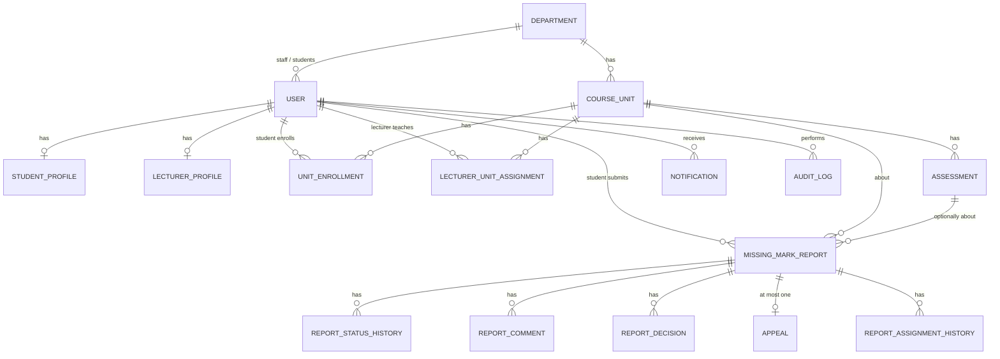

# Database Design

PostgreSQL + Prisma ORM + Prisma Migrate. This is the **agreed conceptual model**; `backend/prisma/schema.prisma` must match it. Any schema change updates this file in the same PR (see `CONTRIBUTING.md` §9).

**Phase tags:** **P1** = Phase 1 MVP (all P1 models land together in the first schema PR so nobody has conflicting schema work), P2/P3/P4 = added by the module owner when that phase starts.

---

## 1. Conventions

| Topic | Convention |
|---|---|
| Table / column names | `snake_case`, plural tables (`missing_mark_reports`). Prisma models are `PascalCase` singular with `@@map` / `@map` |
| Primary keys | `id` UUID (`@default(uuid())`) |
| Timestamps | `created_at`, `updated_at` on every table; stored as UTC |
| Soft state | Prefer explicit columns (`is_active`, `withdrawn_at`, `closed_at`) over deleting rows |
| Enums | Prisma enums, `UPPER_SNAKE_CASE` values |
| Foreign keys | Always declared; `onDelete: Restrict` by default (history must survive) |
| Secrets | Never store plaintext passwords, reset tokens, refresh tokens or 2FA secrets — store hashes / encrypted values |
| Sensitive data | Classroom coordinates are sensitive; don't expose them to ordinary users |
| IDs shown to humans | `public_reference` e.g. `MMR-2026-000001` (report) — separate from the UUID |
| Transactions | Required for: report submit (+history+audit+notification), status transition (+history+audit+notification), attendance record + history + audit |

---

## 2. Enums

| Enum | Values | Phase |
|---|---|:--:|
| `Role` | `STUDENT`, `LECTURER`, `COD`, `ADMIN` | 1 |
| `ReportStatus` | `PENDING`, `UNDER_REVIEW`, `APPROVED_BY_LECTURER`, `REJECTED_BY_LECTURER`, `APPEALED`, `UNDER_COD_REVIEW`, `APPROVED_BY_COD`, `REJECTED_BY_COD`, `CLOSED` | 1 |
| `CaseClassification` | `NORMAL`, `SPECIAL` (column nullable until eligibility exists) | 1 |
| `DecisionLevel` | `LECTURER`, `COD` | 1 |
| `DecisionOutcome` | `APPROVE`, `REJECT` | 1 |
| `CommentType` | `GENERAL`, `REQUEST_FOR_INFORMATION`, `DECISION_REASON` | 1 |
| `AppealStatus` | `SUBMITTED`, `UNDER_REVIEW`, `DECIDED` | 1 |
| `NotificationChannel` | `IN_APP`, `EMAIL` | 1 |
| `AttendanceSessionType` | `CLASS`, `CAT` | 2 |
| `AttendanceSessionStatus` | `DRAFT`, `OPEN`, `CLOSED`, `EXPIRED` | 2 |
| `AttendanceStatus` | `PRESENT`, `LATE`, `EXCUSED`, `ABSENT` | 2 |
| `LocationCheckStatus` | `PASSED`, `FAILED`, `NOT_REQUIRED` | 2 |
| `DiscrepancyStatus` | `SUBMITTED`, `UNDER_REVIEW`, `RESOLVED`, `ESCALATED`, `CLOSED` | 2 |
| `AssessmentType` | `CAT`, `EXAM` | 3 |
| `CatVerificationStatus` | `UNCONFIRMED`, `CONFIRMED`, `VERIFIED`, `NEEDS_REVIEW` | 3 |
| `SpecialCaseType` | `SICKNESS`, `BURIAL`, `SPECIAL_EXAM_APPLICATION`, `FEE_RELATED_DENIAL`, `OTHER` | 3 |

---

## 3. Entities

Types are indicative. `?` = nullable. All entities also have `created_at` / `updated_at` unless noted.

### 3.1 Identity and structure (Phase 1)

**StudentRegistry** *(mock university data — read-only reference used for registration and password reset)*
`id` · `registration_number` (unique) · `full_name` · `official_email` (unique) · `program` · `year_of_study` · `status` (ACTIVE/INACTIVE) · `department_id`
> Seeded with clearly fake data. Registration succeeds only if the number exists here and isn't already linked to a user.

**User**
`id` · `role` (Role) · `registration_number?` (unique, students) · `staff_number?` (unique, staff) · `full_name` · `email` (login/notification, unique) · `official_email?` · `password_hash` · `department_id?` · `is_active` (default true) · `failed_login_attempts` (default 0) · `locked_until?` · `last_login_at?` · `two_factor_enabled` (default false) · `two_factor_secret?` *(encrypted, P4)* · `notification_email?` *(validated before first submission, BR-14)*
Indexes: `role`, `department_id`.

**StudentProfile** — `id` · `user_id` (unique FK) · `registration_number` · `program` · `year_of_study` · `status`
**LecturerProfile** — `id` · `user_id` (unique FK) · `staff_number` · `department_id` · `status`

**Department** — `id` · `name` · `code` (unique) · `is_active`
**CourseUnit** — `id` · `code` (unique) · `name` · `department_id` · `is_active`

**UnitEnrollment** — `id` · `student_id` (FK User) · `unit_id` · `academic_year` · `semester` · `status`
Unique: (`student_id`, `unit_id`, `academic_year`, `semester`).

**LecturerUnitAssignment** — `id` · `lecturer_id` (FK User) · `unit_id` · `academic_year` · `semester` · `is_active`
Unique: (`lecturer_id`, `unit_id`, `academic_year`, `semester`). Drives auto-assignment and lecturer scope.

**RefreshToken** *(added for rotation/revocation)* — `id` · `user_id` · `token_hash` (unique) · `expires_at` · `revoked_at?` · `replaced_by_id?` · `user_agent?`
Never store the raw token.

### 3.2 Missing-mark cases (Phase 1)

**Assessment** *(P1: minimal; extended in P3)* — `id` · `unit_id` · `name` · `type` (AssessmentType) · `assessment_date?` · `maximum_marks` · `required_for_eligibility` (default false) · `created_by`
> Needed in P1 so reports can reference an assessment and mark limits can be checked. Seeded with mock CAT/exam rows.

**MissingMarkReport**
`id` · `public_reference` (unique) · `student_id` · `unit_id` · `assessment_id?` · `academic_year` · `semester` · `year_unit_taken` · `description` · `status` (ReportStatus, default PENDING) · `case_classification?` · `eligibility_summary?` *(JSON explanation, nullable)* · `assigned_lecturer_id?` *(null = assignment queue)* · `department_id` *(denormalized from unit for COD scoping)* · `submitted_at` · `review_started_at?` · `closed_at?` · `withdrawn_at?` · `appeal_used` (bool, default false) · `is_overdue` (default false) · `lecturer_due_at?` · `cod_due_at?` · `reopened_count` (default 0)
Indexes: `status`, `assigned_lecturer_id`, `department_id`, `unit_id`, `student_id`, `submitted_at`, `is_overdue`.
**Active-duplicate rule (BR-01):** a *partial unique index* on (`student_id`, `unit_id`, `assessment_id`) where `withdrawn_at IS NULL AND status <> 'CLOSED'`. Prisma cannot declare partial indexes, so add it as a hand-written SQL statement inside the migration, **and** check in the service for a friendly error. (`assessment_id` null needs `COALESCE` handling — settle in review, see D-02.)

**ReportStatusHistory** *(user-visible timeline; separate from audit)* — `id` · `report_id` · `from_status?` · `to_status` · `actor_id?` (null = system) · `reason?` · `created_at`

**ReportComment** — `id` · `report_id` · `author_id` · `comment_type` · `comment_text` · `is_locked` (bool) · `edited_at?`
Lecturer comments get `is_locked = true` when COD review starts (BR-07).

**ReportDecision** — `id` · `report_id` · `decision_level` · `decision` (APPROVE/REJECT) · `reason?` (mandatory when lecturer rejects) · `decided_by` · `decided_at` · `original_mark?` · `proposed_mark?` · `maximum_marks_checked?` · `is_final` (bool, true when case closes → locked)
Decisions are appended; revising before closure creates a new row (previous kept).

**Appeal** — `id` · `report_id` (**unique** → one appeal per case, BR-06) · `student_id` · `reason` · `additional_info?` · `status` · `submitted_at` · `reviewed_by_id?` · `decision?` · `decision_reason?` · `decided_at?`

**ReportAssignmentHistory** — `id` · `report_id` · `from_lecturer_id?` · `to_lecturer_id` · `changed_by` · `reason` · `created_at`

### 3.3 Cross-cutting (Phase 1)

**Notification** — `id` · `recipient_id` · `report_id?` (or generic `entity_type`/`entity_id`) · `channel` · `event_type` · `title` · `message` · `read_at?` · `email_attempted_at?`
Index: (`recipient_id`, `read_at`).

**AuditLog** *(append-only; no update/delete in application code)* — `id` · `actor_id?` · `action` · `entity_type` · `entity_id?` · `reason?` · `previous_values?` (JSON) · `new_values?` (JSON) · `metadata?` (JSON) · `request_id?` · `created_at`
Never store passwords, tokens or document contents. Index: (`entity_type`,`entity_id`), `actor_id`, `created_at`, `action`.

**SystemSetting** — `id` · `key` (unique) · `value` (JSON/text) · `updated_by?` · `updated_at`
P1 seeds defaults (attendance threshold 80, deadlines 3/5, lockout 5/30, upload limit). Admin edit endpoints arrive in P4.

### 3.4 Attendance (Phase 2)

**Classroom** — `id` · `code` · `name` · `department_id?` · `latitude` · `longitude` · `allowed_radius_meters` · `is_active` *(sensitive; restricted access)*

**AttendanceSession** — `id` · `unit_id` · `classroom_id` · `created_by` · `session_type` · `title` · `starts_at` · `ends_at` · `status` · `token_hash` (unique; raw token only shown in link/QR at creation) · `closed_at?`

**AttendanceRecord** *(authoritative)* — `id` · `session_id` · `student_id` · `status` · `recorded_at` · `location_check_status` · `distance_meters?` *(store outcome/distance, not raw coordinates — D-07)* · `correction_state` · `created_by?`
Unique: (`session_id`, `student_id`).

**AttendanceHistory** *(separate dashboard entry)* — `id` · `attendance_record_id` (unique) · `student_id` · `unit_id` · `session_title` · `status_snapshot` · `signed_at` · `correction_note?` · `deleted_by?` *(if admin deletion is implemented as hard delete, log in AuditLog instead)*

**AttendanceCorrection** — `id` · `attendance_record_id` · `old_status` · `new_status` · `reason` · `corrected_by` · `created_at`

**AttendanceDiscrepancy** — `id` · `student_id` · `unit_id` · `attendance_record_id?` · `session_id?` · `assessment_id?` · `explanation` · `status` · `assigned_lecturer_id?` · `resolved_by?` · `resolution_note?` · `resolved_at?`

### 3.5 Assessments and special cases (Phase 3)

**Assessment** *(extended)* — adds required attendance/submission configuration and confirmation/verification deadline settings.
**CatSubmission** — `id` · `assessment_id` · `student_id` · `student_confirmed_at?` · `lecturer_verified_at?` · `verified_by?` · `verification_status` · `comments?`; unique (`assessment_id`,`student_id`).
**ExaminationQrReference** — `id` · `assessment_id` · `token_hash` (unique) · `is_active` · `expires_at?`
**ExaminationAttendance** — `id` · `assessment_id` · `student_id` · `qr_reference_id` · `status` (PRESENT) · `recorded_at`; unique (`assessment_id`,`student_id`).
**SpecialCase** — `id` · `report_id` · `circumstance_type` · `student_description` · `review_status` · `reviewer_comments?`
**SpecialCaseEvidence** — `id` · `special_case_id` · `original_filename` · `stored_filename` · `storage_path` · `mime_type` · `size_bytes` · `uploaded_by` · `uploaded_at`. Only special-case documents live here.
**ReportDraft** — separate table (decision P-04): `id` · `student_id` · `payload` (JSON) · `last_saved_at` · `expires_at`. A draft is **not** a report until submitted.

### 3.6 Admin / platform (Phase 4)
**PasswordResetToken** *(Phase 2)* — `id` · `user_id` · `token_hash` · `expires_at` · `used_at?`
**ArchivedRecordAccess** — `id` · `admin_id` · `entity_type` · `entity_id` · `reason` · `accessed_at`

---

## 4. Relationships overview

Phase 2+ relations: `AttendanceSession` 1—N `AttendanceRecord` (N—1 student); `AttendanceRecord` 1—1 `AttendanceHistory`; `Assessment` 1—N `CatSubmission` / `ExaminationAttendance`; `MissingMarkReport` 1—0..1 `SpecialCase` 1—N `SpecialCaseEvidence`.

---

## 5. Integrity requirements

| Rule | Enforced by |
|---|---|
| Unique registration/staff number, email, case reference | Unique constraints |
| One active report per student/unit/assessment (BR-01) | Partial unique index (SQL in migration) + service check |
| One appeal per report (BR-06) | Unique `report_id` on `Appeal` + `appeal_used` flag |
| One attendance record per student/session (BR-21) | Unique (`session_id`,`student_id`) + service check |
| One exam attendance per student/assessment | Unique constraint |
| One enrollment per student/unit/year/semester | Unique constraint |
| Valid status transitions | State-machine module (not the database) |
| Audit append-only | No update/delete in code; later: restrict DB role privileges |
| History survives deactivation | `is_active` flag, `Restrict` deletes |

**Reference generation:** `MMR-<year>-<zero-padded 6-digit sequence>`. Use a database sequence (or counter row locked in the transaction) so concurrent submissions never collide. The year resets numbering or not — decision P-08; default: one continuous sequence.

## 6. Seed data (mock only)

One department (e.g. Computer Science), two units with assessments (CAT 1, Exam), 1 admin, 1 COD, 2 lecturers, 3–4 students (in both `StudentRegistry` and `User`), enrollments, lecturer assignments (one unit deliberately **unassigned** to test the assignment queue), default `SystemSetting` rows. All emails use a reserved fake domain (e.g. `@mock.kisiiuniversity.test`). Seed credentials are documented in `backend/README.md` and are for development only.

## 7. Migration policy

- One migration per logical change, named descriptively (`add_report_tables`).
- Never edit a merged migration; add a new one.
- Test every migration on a clean database before opening the PR.
- Destructive changes (drop/rename column) need lead approval in the issue first.
