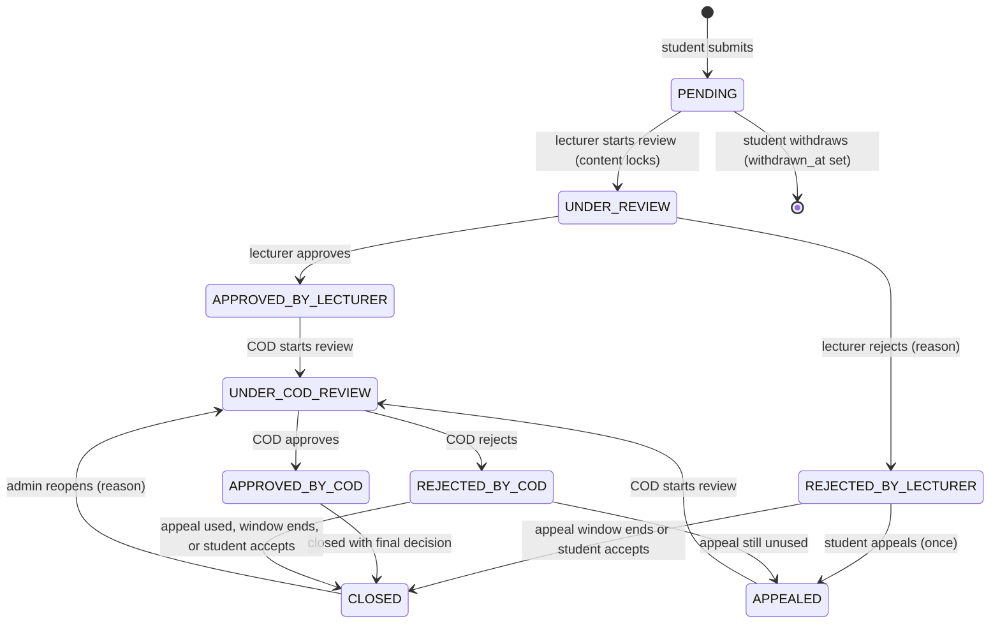
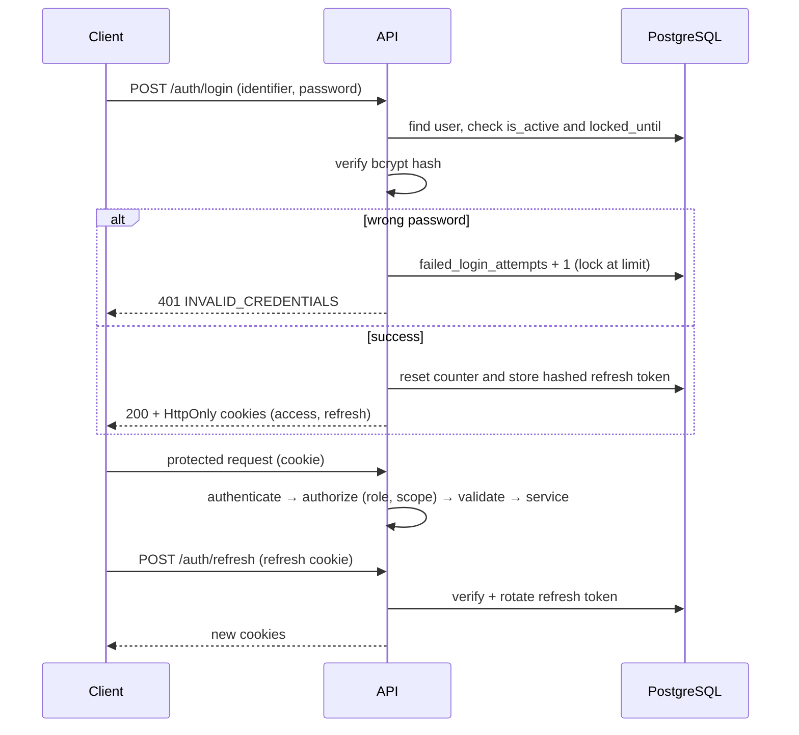
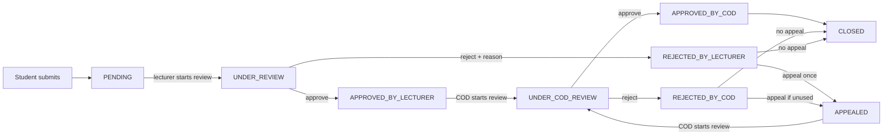
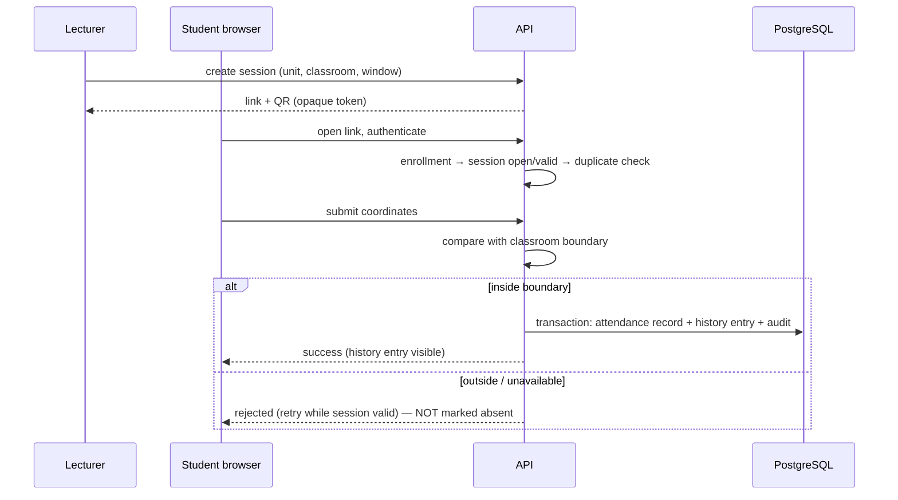

# Workflows

Source of truth for process rules. Business-rule IDs (**BR-xx**) are defined in `docs/requirements/requirements.md`. If you change a rule here, record the decision in `docs/design/meeting-notes/` first.

Diagrams use Mermaid (rendered by GitHub).

---

## 1. Missing-mark report status model

Nine primary statuses. **Withdrawn** and **Overdue** are *not* statuses:
- Withdrawn = `withdrawn_at` timestamp is set (report stays in database/history).
- Overdue = `is_overdue` flag; the primary status is unchanged (e.g. Under Review + Overdue).

> **Appeal window decided (P-03): 7 days** (setting `appeal_window_days`); the student may also accept the decision. Exact appeal points still to confirm in D-03. The diagram is the working baseline for Phase 1.

### 1.1 Transition table (implement as one state-machine module + unit tests)

| # | From | Action | Actor | To | Guards | Side effects |
|---|---|---|---|---|---|---|
| T1 | – | Submit | Student (owner) | PENDING | Enrolled in unit; no active duplicate (BR-01); notification email present (BR-14); fields valid | Reference generated; auto-assign lecturer or leave unassigned (BR-11); eligibility evaluated; due date set; audit + notification (one transaction) |
| T2 | PENDING | Edit | Student (owner) | PENDING | Status is Pending (BR-03) | Audit with previous/new values |
| T3 | PENDING | Withdraw | Student (owner) | (withdrawn_at set) | Status is Pending (BR-03) | Audit; notification to lecturer |
| T4 | PENDING | Start review | Assigned lecturer | UNDER_REVIEW | Lecturer is the assignee | `review_started_at` set; content locked (BR-04); notify student |
| T5 | UNDER_REVIEW | Approve | Assigned lecturer | APPROVED_BY_LECTURER | Optional proposed mark ≤ assessment max (BR-09) | Decision recorded; notify student + COD |
| T6 | UNDER_REVIEW | Reject | Assigned lecturer | REJECTED_BY_LECTURER | **Reason mandatory** (BR-05) | Decision recorded; notify student (appeal possible) |
| T7 | APPROVED_BY_LECTURER | Start COD review | COD (department) | UNDER_COD_REVIEW | Report in COD's department | Lecturer comments become immutable (BR-07); notify student |
| T8 | REJECTED_BY_LECTURER / REJECTED_BY_COD | Appeal | Student (owner) | APPEALED | No appeal yet (BR-06); reason mandatory | Appeal row created; original report, comments, decisions attached by reference; notify COD |
| T9 | APPEALED | Start COD review | COD | UNDER_COD_REVIEW | Same department | notify student |
| T10 | UNDER_COD_REVIEW | COD approve | COD | APPROVED_BY_COD → CLOSED | Marks (if any) ≤ max; reason/comment recorded | Final decision locked at close (BR-08); notify student; `closed_at` |
| T11 | UNDER_COD_REVIEW | COD reject | COD | REJECTED_BY_COD (→ CLOSED if appeal already used) | Reason mandatory | If appeal unused → appealable; else closes; notify student |
| T12 | REJECTED_BY_* | Accept decision / window expires | Student / system job | CLOSED | – | Audit; notify |
| T13 | CLOSED | Reopen | Admin | UNDER_COD_REVIEW | Reason mandatory (BR-13) | Audit; notify COD + student |

Any transition not in this table must be rejected with `409 INVALID_STATE_TRANSITION`. Each applied transition writes one `ReportStatusHistory` row and one audit entry.

### 1.2 Comments and decisions
- Lecturer comments: editable until COD review begins; after that immutable; new comments are still allowed (BR-07).
- COD may adjust comments and the decision until the case is Closed; after Closed the final decision is locked (BR-08).
- Decisions are recorded as new rows, never overwritten silently.
- Marks: lecturer may *propose* a mark (original value preserved if known, within assessment maximum); COD approval is required; official results are never touched (BR-09).

---

## 2. Authentication flow

**Registration (student):** student supplies registration number + email + password. The system looks up the registration number in the **mock student registry**; if found and not already registered, creates the user + profile. Staff accounts are created by an administrator (provisioned).
**Lockout:** 5 consecutive failures → locked for 30 min (configurable). Login/logout/lockout events are audited.
**Password reset (Phase 2):** student enters registration number → system sends a time-limited reset link/code to the *official university email* from the registry (mock email in development) → reset → audit.

---

## 3. Report submission and assignment

1. Student chooses an enrolled unit (and assessment if applicable) and describes the missing mark.
2. System validates fields (Zod), checks enrollment, checks the duplicate rule, checks a notification email exists.
3. In **one transaction**: create report (PENDING) + status history + audit + notification; generate reference `MMR-<year>-<6-digit sequence>`.
4. Look up the lecturer via `LecturerUnitAssignment` (active, matching academic year/semester). Found → assign. Not found → leave unassigned; the case appears in the COD/admin **assignment queue**.
5. Set lecturer deadline (default 3 working days).
6. Evaluate eligibility (Phase 1: stub returns "not evaluated"; Phase 3: real classification).

**Reassignment:** COD (own department) or admin; record old/new assignee, actor, time, reason; notify both lecturers.

---

## 4. Lecturer review → COD decision (main path)

---

## 5. Appeal workflow

1. Allowed only after a permitted rejection (lecturer or COD) and only if no appeal exists for the case (database unique constraint on `report_id` backs this).
2. Student supplies a mandatory reason (+ optional extra information; new special-case evidence from Phase 3).
3. System attaches the original report, earlier comments/decisions and timestamps (by reference to existing records).
4. Status → APPEALED → COD review → final decision → CLOSED, student notified. A second appeal returns `409 APPEAL_ALREADY_USED`.

---

## 6. Deadlines and overdue (Phase 4 job; fields exist from Phase 1)

| Stage | Default deadline | When exceeded |
|---|---|---|
| Lecturer (from submission) | 3 working days | `is_overdue` = true; notify lecturer + COD; COD may reassign |
| COD (from entering COD review) | 5 working days | `is_overdue` = true; notify COD + admin + student; admin may escalate/reassign |

Both values are settings. Working days = Monday–Friday unless a holiday calendar is configured. A simple scheduled task (e.g. `node-cron`) checks periodically; no event bus.

---

## 7. Eligibility engine

Inputs from the application's own records: class attendance %, required CAT attendance, confirmed exam attendance.

| Condition | Satisfied when |
|---|---|
| Class attendance | Attended ÷ applicable sessions × 100 ≥ threshold (default 80, setting) |
| CAT attendance | Every CAT configured as required for the unit has status **Present** |
| Exam attendance | Examination attendance record exists (validated QR scan) |

Result: `NORMAL` if all satisfied, otherwise `SPECIAL`, with a per-condition explanation (satisfied / missing / unresolved). **Advisory only** — never auto-rejects and never judges special circumstances (BR-15). Phase 1 returns "not evaluated" until attendance data exists.

---

## 8. Class attendance (Phase 2)

Validation order (backend): authenticated → enrolled → session exists/open/within window → not duplicate → location. Link and QR resolve to the same session and go through identical checks.
**Session closure:** students with no valid record are *listed for lecturer review*, not auto-marked absent. Lecturer corrections require reason + audit (BR-25).

**Attendance history vs record:** the record is authoritative and backend-written; the history entry is a separate row created only after the record succeeds. Implement both in one transaction so they cannot diverge (decision D-10).

---

## 9. Attendance discrepancy (Phase 2)

Student submits (unit, session/assessment, history entry concerned, explanation — **no file upload**) → lecturer notified and investigates → **resolve with audited correction** (original preserved) or **escalate** → COD notified and decides escalated cases. Statuses: SUBMITTED → UNDER_REVIEW → RESOLVED | ESCALATED → CLOSED.

---

## 10. CAT attendance and submission (Phase 3)

Lecturer creates the CAT assessment + session (link/QR) → student signs attendance (same checks as class attendance) and physically hands in the CAT (either order) → student confirms submission in the system → lecturer verifies. Three separate records. Missing confirmation/verification can be **flagged for review**, but it never proves absence. Only **Present** satisfies normal eligibility.

## 11. Examination attendance (Phase 3)

Each booklet carries a QR containing only an opaque reference to the exam assessment. Student scans → authenticates → backend validates reference, assessment, student, eligibility/session conditions, duplicate → records **Present**. A scan without successful validation counts for nothing. Conflicts with external registers go through the discrepancy workflow.

## 12. Special cases and evidence (Phase 3)

Student declares a circumstance (sickness, burial, special exam application, fee-related denial, other recognized) and uploads permitted evidence (PDF/JPG/JPEG/PNG, size limit from settings, generated filename, stored outside public static folder, served only through an authorized endpoint). Lecturer/COD review; the system never decides validity. After closure evidence is not shown on the ordinary student dashboard; authorized staff access follows role and is audited. Evidence is **never** attendance proof.

## 13. Notifications

Events (examples): report submitted · review started · lecturer approved/rejected · COD review started · COD approved/rejected · appeal submitted · case closed · comment added · reassignment · overdue · discrepancy/correction/escalation · CAT verified.
Each event creates an in-app notification row; email goes through an email-provider interface (development: logs the email). Users can mark notifications read/unread. No SMS, no real-time push — clients fetch via the API.

## 14. Administrative flows (Phase 4)

- **Maintenance mode:** ordinary users get `503 MAINTENANCE_MODE`; admins pass through.
- **Archive:** archived records are read-only; admin access needs a recorded reason (audited).
- **Reopen:** admin only, reason mandatory (T13).
- **Attendance-history deletion:** admin only, audited.
- **Exports:** PDF/Excel follow the same role scope as on-screen data; may be audited.
